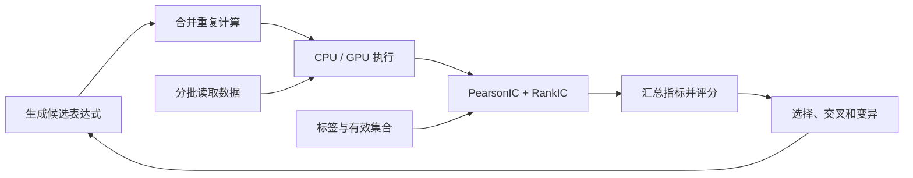

# FactorEngine

FactorEngine 是面向量化因子研究的计算引擎，将遗传编程搜索、批量因子计算和多期限评价连接起来，提供 C++/OpenMP 与 CUDA 两种执行后端。

因子搜索会让同一批行情反复经过大量表达式、窗口运算和相关性计算。FactorEngine 把整个种群编译为共享计算图，复用重复的子表达式，再按标的分批执行；不同预测期限共用因子结果，减少重复计算和数据搬运。

Python 组织表达式、数据和搜索流程，C++/OpenMP 与 CUDA 承担计算。生产评分同时计算 **PearsonIC 和 RankIC**，GPU 在同一个融合 kernel 中完成两项指标。项目提供统一的数据接口和数值检查，便于在相同输入上核对 CPU/GPU 的结果与耗时。

## 工作流程



两项 IC 都按每只标的的时间序列计算，再按期限汇总并返回。默认搜索评分使用加权 RankIC 和复杂度惩罚，也可通过自定义评分使用 PearsonIC 或组合指标；评分规则不影响两项 IC 的计算。

## 运行

需要 Python 3.10+、CMake 3.24+、C++17 和 OpenMP。使用 GPU 时还需要 NVIDIA GPU 和 CUDA Toolkit。

```bash
python3 -m venv .venv
.venv/bin/python -m pip install -e '.[dev]'
cmake -S . -B build-study -DCMAKE_BUILD_TYPE=RelWithDebInfo -DFACTORENGINE_ENABLE_CUDA=ON
cmake --build build-study --parallel 2

.venv/bin/python -m examples.multitarget_search --backend cpu --output build-study/cpu.json
.venv/bin/python -m examples.multitarget_search --backend gpu --output build-study/gpu.json
```

只用 CPU 时，将 `FACTORENGINE_ENABLE_CUDA` 设为 `OFF`。示例使用合成数据，默认搜索 8 个表达式、演化 2 代；可用 `--population-size`、`--generations`、`--horizons` 调整规模。例如 `--horizons 2 5 30` 表示预测未来 2、5、30 个采样点。

## 代码结构

```text
python/factor_engine/   表达式、编译、搜索和后端调用
cpp/                   C++ / OpenMP 计算后端
cuda/                  CUDA 算子与融合 IC kernel
examples/              运行示例
tests/                 正确性检查
```

GPU 根据序列长度选择短序列或长序列融合核；每个 CTA 处理一个因子、一只标的和一个期限，同时输出两项 IC。

主要入口是 `FactorEngine.search_multitarget()` 和 `score_population_multitarget()`，分别用于搜索和固定种群评分。完整调用方式见 [多期限示例](examples/multitarget_search.py)。

## 阅读导航

| 想了解的内容 | 位置 |
| --- | --- |
| 环境、运行方式和整体流程 | 本页 |
| CPU/GPU 性能、有效率与 kernel 对照 | [性能说明](docs/performance.md) |
| 搜索与多期限评分的用法 | [运行示例](examples/) |
| 表达式编译与搜索循环 | [ir.py](python/factor_engine/ir.py)、[engine.py](python/factor_engine/engine.py) |
| GPU 算子与短、长序列融合核 | [pointwise.cuh](cuda/pointwise.cuh)、[metric_short.cuh](cuda/metric_short.cuh)、[metric_long.cuh](cuda/metric_long.cuh) |
| 正确性用例与验证入口 | [tests](tests/)、[validate.py](scripts/validate.py) |

## 数据与检查

评分需要两组按标的和时间对齐的数据：表达式算出的因子值，以及对应预测期限的未来收益率标签。样本末尾缺少未来价格、价格缺失等情况会使标签不可用，因此每个标签还带有一个“是否允许评分”的布尔标记，代码中称为 `eligible`。

**标签有效率**是允许评分的标签占全部标签的比例。实际计算两项 IC 时，还要排除因子或标签中的 NaN、Inf；剩余点占全部点的比例称为**联合有效率**。标签有效率随预测期限、标的和时段变化；因子的窗口预热还会进一步影响联合有效率。

相同值使用平均秩；联合有效点不足三个或序列为常数时，相关系数返回 NaN。输入特征应在当时已知，未来标签只用于评分，不跨交易时段拼接。

以 C++ FP64 为参考，三档仿真的 307200 对输入均通过数值验收：RankIC 逐值一致、NaN 分类一致，FP32 Pearson 满足 `|GPU-CPU| <= 3e-7 + 2e-5 × |CPU|`，最大绝对误差为 2.01e-7。这是本项目的工程精度标准；接近零时仍可能有较大相对误差，具体样本及除零处理见 [精度说明](docs/performance.md#pearson-精度)。

运行现有检查：

```bash
.venv/bin/python -m scripts.validate
```

加 `--gpu` 可检查 CUDA 后端。

## 性能

测量使用 i9-14900K 与 RTX 5070 Ti，256 个表达式、400 只仿真标的、每条序列 23400 点，预测未来 30 个采样点。固定同一组表达式和行情，仅改变标签有效率；取五轮交替测量的中位数。两种后端均计算 PearsonIC 和 RankIC。

**完整一次种群评分**，包括数据准备、因子计算、两项 IC、汇总和结果回传：

| 标签有效率 | C++/OpenMP | CUDA | 加速比 |
| --- | ---: | ---: | ---: |
| 99.86% | 25.389 s | 1.501 s | 16.91× |
| 50.00% | 22.487 s | 1.420 s | 15.83× |
| 30.47% | 17.159 s | 1.394 s | 12.31× |

**GPU 两项 IC 计算**，因子与标签已在显存中，不含因子计算和数据传输：

| 标签有效率 | CUB 排序 + 独立 Pearson | 融合 kernel | 加速比 |
| --- | ---: | ---: | ---: |
| 99.86% | 397.027 ms | 287.163 ms | 1.38× |
| 50.00% | 382.865 ms | 193.555 ms | 1.98× |
| 30.47% | 389.631 ms | 160.386 ms | 2.43× |

第二张表的加速比仅比较两种 GPU 实现。三档标签有效率对应的联合有效率为 93.71%、46.92%、28.60%。主机线程配置、两种 Pearson 的精度差别和 kernel 分析见 [性能说明](docs/performance.md)。

项目使用 [Apache 2.0](LICENSE) 许可证。
